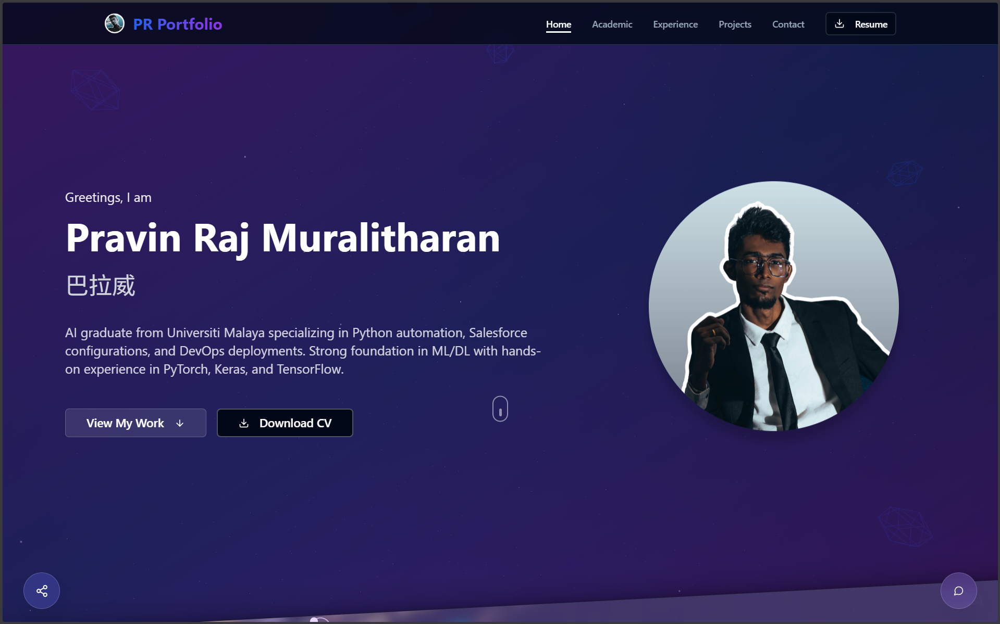
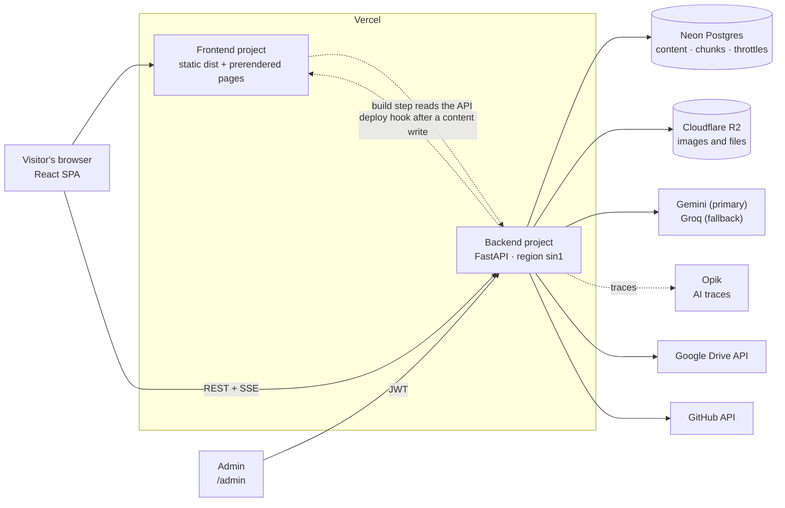
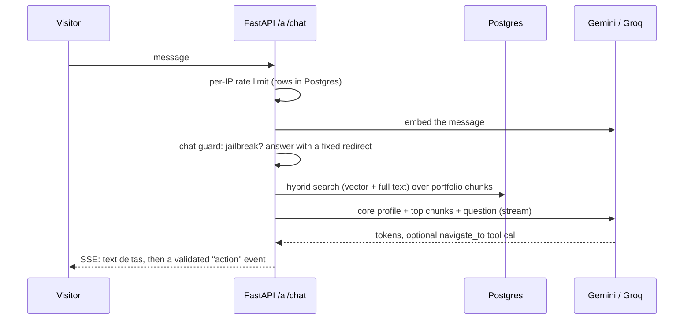

<p align="center">
  <a href="https://pravinraj.dev">
    
  </a>
</p>

<h1 align="center">PR Portfolio</h1>

**A dual-mode portfolio with an admin dashboard, an AI chatbot that answers from the portfolio's own content, and a static-prerendered SEO layer.**

<p align="center">
  <a href="https://pravinraj.dev"><strong>pravinraj.dev</strong></a>
</p>

| | |
| --- | --- |
| **Site** | [pravinraj.dev](https://pravinraj.dev) |
| **API** | `https://api.pravinraj.dev/api/v1` |
| **Frontend** | React 18, TypeScript, Vite, Bun |
| **Backend** | FastAPI (async), Neon Postgres, Cloudflare R2 |

Every page, project, job, certificate and line of copy is stored in Postgres and edited from a private admin dashboard on the same site. There is no redeploy to change content.

---

## Contents

- [Features](#features)
- [The two modes](#the-two-modes)
- [How it works](#how-it-works)
  - [Architecture](#architecture)
  - [The chatbot](#the-chatbot)
  - [Admin sessions](#admin-sessions)
  - [SEO and prerendering](#seo-and-prerendering)
- [Tech stack](#tech-stack)
- [Getting started](#getting-started)
  - [Frontend](#frontend)
  - [Backend](#backend)
  - [Environment variables](#environment-variables)
  - [Tests](#tests)
- [Deployment](#deployment)
- [Project structure](#project-structure)
- [Security and privacy](#security-and-privacy)
- [Limitations](#limitations)
- [Issues and contributions](#issues-and-contributions)
- [License](#license)

---

## Features

| Area | What it does |
| --- | --- |
| **Dual mode** | One site, two presentations: **Professional** and **Creative**. Each mode has its own home page and its own set of visible pages, and visitors can switch between them without a reload. |
| **Content, all from the database** | Hero, about, projects, experience, education, certifications, skills, services, stats, socials, resume and contact copy are all rows in Postgres, served by the API. |
| **Projects** | Card, slider and timeline views, project folders, image galleries with sub-folders, and a detail page per project. |
| **Experience and academic** | Timeline of roles with a detail page per role, plus education, certifications and achievements. |
| **AI chatbot** | A streaming assistant that answers from the portfolio's own data using retrieval, with voice input and read-aloud, and the ability to take a visitor to a page ("show me your React projects"). |
| **Magazine and podcast** | An AI-assisted magazine viewer and a podcast page, both managed from the admin. |
| **Playground** | Two small games, Terminal Quest and Neon Breakout, with a global leaderboard. Unlocked with the Konami code, or at `/playground`. |
| **Admin dashboard** | Full content management at `/admin`: drag-and-drop ordering, Google Drive picker, image crop preview, per-mode page visibility, visitor stats and AI observability. |
| **AI-assisted authoring** | Generate a description for a project, generate a magazine issue, or import a GitHub repository as a draft project that you review before saving. |
| **SEO and answer engines** | Every visible page is prerendered to static HTML with meta tags and JSON-LD, plus a sitemap, `llms.txt` and `llms-full.txt`. |
| **Live extras** | Visitor counter, a GitHub activity ticker, splash screen, onboarding popup and cursor follower. |
| **Dark mode and responsive layout** | Designed for phone, tablet and desktop. |

## The two modes

The mode is part of the URL, so each mode is a real, linkable, indexable set of pages.

| URL | What you get |
| --- | --- |
| `/` | The home page of whichever mode is set as the default in the admin |
| `/pro`, `/pro/projects`, `/pro/experience`, `/pro/academic`, `/pro/contact` | Professional mode |
| `/creative`, `/creative/projects`, … | Creative mode |
| `/projects/:id`, `/experience/:id` and the other unprefixed list pages | Redirect to the mode that owns the page (a permanent 301 for the list pages) |
| `/playground` | The arcade |
| `/admin` | The dashboard, login required |

Which pages exist in each mode is configured in the admin (**Settings → Modes**). A page that is hidden in a mode returns a real not-found page for that mode, and is left out of the sitemap.

## How it works

### Architecture



| Piece | Runs on | Job |
| --- | --- | --- |
| `src/` | Browser | The React app: routing, the two modes, all pages, the chatbot widget and the admin. |
| `scripts/prerender.ts` | Build time | Writes static HTML, sitemap and `llms*.txt` for every visible page, from live API data. |
| `backend/app/api/routers/` | Vercel Function | One router per content type, plus `auth`, `ai`, `drive`, `observability`. |
| `backend/app/services/` | Vercel Function | R2 storage, the LLM gateway, RAG indexing, the chat guard, tracing, throttles, GitHub and Drive clients. |
| `backend/alembic/` | Run by hand | Schema migrations, applied against the direct (unpooled) Neon URL. |

All backend I/O is `async`/`await`: SQLAlchemy 2.0 async sessions over `asyncpg`, `aioboto3` for R2, `httpx` for everything else.

### The chatbot

The public chat route streams server-sent events. A message goes through four stages before any LLM tokens are spent on it.



- **Retrieval.** Every retrievable row is turned into a self-contained text chunk with an embedding (`pgvector`) and a full-text vector. Each question gets the owner's core profile plus the few best chunks, instead of the whole portfolio. Reindexing happens from the admin and after content saves. If retrieval fails at request time, the route falls back to the full-portfolio prompt.
- **Providers.** Gemini is tried first and Groq takes over on a 429 or 5xx. Model names are environment variables, so a retired free model can be swapped without a code change.
- **Guard.** Messages that are clearly jailbreak attempts are matched against labelled example vectors and answered with a fixed redirect. The guard reuses the embedding RAG already computed, so it costs no extra API call, and it fails open if its index is missing.
- **Navigation.** The model can call a `navigate_to` tool. The backend validates the target against a fixed list of pages and the database, and the widget performs it as a route change.
- **Voice.** Speech recognition for input and speech synthesis for read-aloud, in the browser.
- **Observability.** Each request is traced to Opik, with per-step timings, token usage, retrieval and guard details. The admin **AI** tab shows an overview, traces, evaluation scores and guard behaviour.

### Admin sessions

Admin auth is a bearer JWT stored in `localStorage`, with passwords hashed with argon2.

- Tokens last 60 minutes (`JWT_EXPIRE_MINUTES`).
- While the dashboard is open, the token is renewed in the background through `POST /auth/refresh`, so an hour of editing never ends in "Not authenticated".
- Renewal is refused once the password was last typed more than 7 days ago, so a real login is still needed weekly.
- If the session does expire, a sign-in dialog opens **over** the page. The editor underneath stays mounted, so unsaved form edits survive.
- Failed logins are throttled per email and per IP, counted in Postgres because serverless instances don't share memory.

### SEO and prerendering

A single-page app serves crawlers an empty shell. To avoid that, `bun run build` runs `scripts/prerender.ts` after `vite build`:

- For every page that is currently visible, it writes `dist/<path>/index.html` with the right `<title>`, description, canonical, Open Graph and Twitter tags, per-page JSON-LD, and a small semantic HTML summary. React replaces that summary when it loads, so users still get the normal app.
- It writes `404.html`, `sitemap.xml`, `llms.txt` and `llms-full.txt`.
- All titles and structured data come from `src/lib/seo.ts`, the same builders the live pages use, so the prerendered output can't drift from the app.
- After an admin content write, the backend pings a Vercel **Deploy Hook** so the next build picks the change up. This is best-effort and never delays or fails the save.
- `robots.txt` keeps `/admin` out and explicitly welcomes the major AI search and answer-engine crawlers.

The prerender step fails the build on any error, so a broken run never ships a stale or partial `dist/`.

## Tech stack

| Layer | Choice | Why |
| --- | --- | --- |
| UI | **React 18**, **TypeScript**, **Vite** | Fast dev loop, typed API contracts. |
| Runtime and package manager | **Bun** | Install, scripts and the prerender script all run on it. |
| Styling and components | **Tailwind CSS**, **shadcn/ui** (Radix) | Accessible primitives, consistent design tokens. |
| Motion and 3D | **Framer Motion**, **Swiper**, **Three.js** with React Three Fiber | Page transitions, sliders, the animated backgrounds. |
| Data fetching | **TanStack Query** and a small `fetch` client | Caching and explicit loading and error states. |
| Drag and drop | **dnd-kit** | Reordering projects and images in the admin. |
| API | **FastAPI**, **Pydantic v2** | Typed, async, auto-validated. |
| Database | **Neon Postgres** with **pgvector**, **SQLAlchemy 2.0** (async), **asyncpg**, **Alembic** | Serverless Postgres with vector search for the chatbot. |
| Storage | **Cloudflare R2** via `aioboto3` | S3-compatible object storage with a public base URL. |
| Auth | **PyJWT**, **argon2** (`pwdlib`) | Stateless bearer tokens, modern password hashing. |
| AI | **Gemini** and **Groq** over OpenAI-compatible endpoints | Free tiers, with automatic failover. |
| Observability | **Opik** (REST), **Vercel Speed Insights** | AI traces and real-user performance. |
| Hosting | **Vercel**, two projects from one repository | Static frontend, Python serverless backend. |
| Tests | **pytest** (backend), **`bun test`** (frontend logic) | 395 backend tests. |

## Getting started

Requirements: [Bun](https://bun.sh), Python 3.11+, and a Postgres database. A free [Neon](https://neon.tech) project works well.

### Frontend

```bash
git clone https://github.com/PravinRaj01/PravinRaj-Portfolio.git
cd PravinRaj-Portfolio

bun install
bun run dev
```

The dev server talks to `http://localhost:8000/api/v1` by default, and production builds talk to `https://api.pravinraj.dev/api/v1`. To point at a different backend, create `.env.local`:

```bash
VITE_API_BASE_URL=http://localhost:8000/api/v1
```

### Backend

```bash
cd backend
python -m venv .venv
.venv/Scripts/activate        # .venv/bin/activate on macOS and Linux

pip install -e ".[dev]"
cp .env.example .env          # then fill it in, see below

alembic upgrade head          # uses DATABASE_URL_DIRECT
python scripts/create_admin.py

uvicorn main:app --reload
```

The API is then on `http://localhost:8000`, with interactive docs at `/docs` unless `ENVIRONMENT=production`.

### Environment variables

Names only. `backend/.env.example` documents every one of them.

| Variable | Required | Purpose |
| --- | --- | --- |
| `DATABASE_URL` | Yes | Neon **pooled** connection, used by the app. |
| `DATABASE_URL_DIRECT` | Yes | Neon **direct** connection, used by Alembic only. |
| `JWT_SECRET` | Yes | Signs admin tokens. |
| `JWT_ALGORITHM`, `JWT_EXPIRE_MINUTES` | No | Token settings (60 minutes by default). |
| `R2_ACCOUNT_ID`, `R2_ACCESS_KEY_ID`, `R2_SECRET_ACCESS_KEY`, `R2_BUCKET`, `R2_PUBLIC_BASE` | For uploads | Cloudflare R2 storage. |
| `CORS_ORIGINS` | Yes | Comma-separated origins allowed to call the API. |
| `CORS_ORIGIN_REGEX` | No | For Vercel preview deployments. |
| `ENVIRONMENT` | No | Set to `production` to disable `/docs`, `/redoc` and `/openapi.json`. |
| `GEMINI_API_KEY`, `GROQ_API_KEY` | For AI | Without either, the AI routes answer 503. |
| `GEMINI_CHAT_MODEL`, `GEMINI_CONTENT_MODEL`, `GROQ_CHAT_MODEL`, `GROQ_CONTENT_MODEL` | No | Model names. |
| `RAG_ENABLED`, `GEMINI_EMBEDDING_MODEL`, `RAG_TOP_K`, `RAG_POOL`, `RAG_MIN_SCORE` | No | Retrieval for the chatbot. |
| `CHAT_GUARD_*` | No | Jailbreak guard thresholds and switches. |
| `CHAT_NAVIGATION_ENABLED` | No | Lets the chatbot take visitors to pages. |
| `OPIK_ENABLED`, `OPIK_API_KEY`, `OPIK_WORKSPACE`, `OPIK_PROJECT_NAME` | No | AI tracing. |
| `GITHUB_TOKEN` | No | Higher rate limit, and private repos, for GitHub import. |
| `GOOGLE_DRIVE_API_KEY` | No | Turns on the Drive browser in the admin. |
| `VITE_API_BASE_URL` | No | Frontend only: overrides the API URL. |

### Tests

```bash
# Backend: 395 tests, run against a throwaway database
cd backend
pytest

# Frontend logic (speech helpers, assistant navigation)
bun test tests/
```

The backend suite reads `backend/.env.test` (git-ignored) and needs `TEST_DATABASE_URL`, `TEST_DATABASE_URL_DIRECT` and `ADMIN_TEST_PASSWORD`. Point those at a separate database or a Neon branch, never at production.

## Deployment

The frontend and backend deploy as **two Vercel projects** from this one repository.

| | Frontend | Backend |
| --- | --- | --- |
| Root directory | `./` | `backend` |
| Detected as | Vite, build command `bun run build`, output `dist` | FastAPI, configured in `backend/vercel.json` (region `sin1`, 60 s max duration) |
| Environment | None required, the API URL is baked into `src/services/apiClient.ts` | Everything in the table above |
| Domain | `pravinraj.dev` | `api.pravinraj.dev` |

1. Create the backend project first and add its environment variables.
2. Run `alembic upgrade head` against `DATABASE_URL_DIRECT`.
3. Add the custom domain and point a CNAME at it.
4. Create the frontend project. Optionally create a **Deploy Hook** and set it on the backend, so content edits rebuild the prerendered pages.

Pushing a branch gives a preview deployment of both projects. Merging to `main` deploys to production. Keep migrations additive, because the schema changes before the code that uses it.

## Project structure

```
.
├── src/
│   ├── components/        UI: pages' building blocks, chatbot/, admin/, games/, ui/ (shadcn)
│   ├── contexts/          PortfolioContext: mode, site settings, page visibility
│   ├── hooks/             One data hook per content type, plus speech and Konami
│   ├── lib/               SEO builders, mode path helpers, speech helpers
│   ├── pages/             Index, Projects, Experience, Academic, Contact, Podcast, Playground, Admin
│   ├── services/          apiClient, authService, Google Drive client
│   ├── types/             Shared TypeScript types
│   └── utils/
├── scripts/
│   └── prerender.ts       Static pages, sitemap and llms.txt (runs after vite build)
├── tests/                 Frontend logic tests (bun:test)
├── public/                Icons, og-image, robots.txt
├── vercel.json            Redirects and rewrites for the mode URLs
└── backend/
    ├── main.py            FastAPI app, CORS, middleware
    ├── vercel.json        Region and function settings
    ├── app/
    │   ├── api/routers/   One module per resource
    │   ├── core/          Settings and security (JWT, hashing)
    │   ├── db/            Engine and session
    │   ├── models/        SQLAlchemy models
    │   ├── schemas/       Pydantic request and response models
    │   └── services/      R2, LLM gateway, RAG, guard, tracing, throttles
    ├── alembic/versions/  Schema migrations
    ├── scripts/           create_admin, data import, eval runners
    └── tests/             pytest suite
```

## Security and privacy

- **No secrets in the repository.** Keys live in Vercel's environment settings and in git-ignored `.env` files. `backend/.env.example` holds names and comments only.
- **Admin-only writes.** Every create, update and delete route sits behind the admin dependency. Public routes are read-only, apart from the visitor counter, game score submission and chat.
- **Rate limiting in Postgres.** Login, chat and score submission are throttled by counting rows, since serverless instances share no memory.
- **Untrusted text is treated as data.** Repository READMEs imported from GitHub and the model's own tool calls are validated, length-capped and never used as-is.
- **What is recorded about visitors.** The visitor counter stores aggregate daily counts only. Chat and login throttling keep an IP address with a timestamp for the length of the rate-limit window. There is no advertising or cross-site tracking.

## Limitations

- **Logout is client-side.** Tokens are stateless JWTs, so signing out drops the token in the browser but doesn't revoke it before it expires.
- **Free-tier AI.** Gemini and Groq quotas are shared across all visitors, so the chatbot can be rate-limited or answer 503 at busy moments.
- **Content changes appear in two steps.** The live app sees an edit immediately, but the prerendered static pages update after the rebuild the deploy hook triggers.
- **Cold starts.** A serverless backend that has been idle takes longer to answer the first request.
- **Single admin.** There is one admin role and no per-section permissions.

## Issues and contributions

This is a personal site, but bug reports and suggestions are welcome: [open an issue](https://github.com/PravinRaj01/PravinRaj-Portfolio/issues).

Changes follow a simple flow: an issue, a branch named `<type>/<issue>-<slug>`, small commits that reference the issue, and a pull request that closes it.

## License

The code is released under the [MIT License](LICENSE).

The personal content of the site (photos, logo, resume and written material) is **not** covered by it and remains all rights reserved. See the [content notice](CONTENT-NOTICE.md) for the exact scope.
